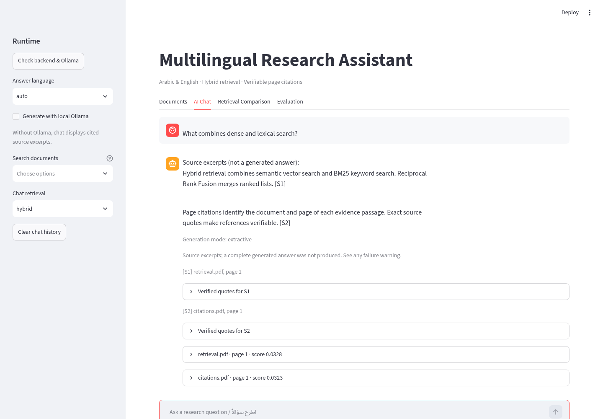

# Multilingual Advanced RAG

An Arabic and English research assistant with page-preserving PDF ingestion,
FAISS + BM25 retrieval, Reciprocal Rank Fusion, optional multilingual cross-encoder
reranking, and local Qwen generation through Ollama. The system includes a FastAPI
backend, a Streamlit dashboard, persistent storage, and reproducible retrieval evaluation.

**项目介绍：** 面向阿拉伯语与英语科研文献的开源检索增强生成系统，结合 FAISS 向量检索、
BM25、倒数排名融合与多语言重排序，使用本地 Qwen 模型生成带页码引用的回答，
并提供检索评测、FastAPI 接口和 Streamlit 可视化。无需付费 API。

## Status and evidence

The uploaded Windows version has been extended with explicit document-scoped retrieval,
focused table comparisons, safer author-list extraction, bounded generation, audit-friendly
evaluation exports, real dashboard screenshots, and a source updater that protects existing
local work. See [current validation](docs/validation-20261016.md),
[current architecture](docs/current-architecture.md), and [safe upgrade instructions](docs/upgrading.md).
Historical Windows diagnosis reports remain available; their test counts are not current
cloud results. Model mode, valid citations and passing unit tests do not imply answer correctness.

The hash/lexical profile is explicitly offline and is **not learned semantic retrieval**.
Source tables and author statements are labeled separately from generated Qwen prose.
Local generation can fall back conservatively; research answers still require source review.
Ordinary Arabic generation remains unreliable in live testing; rejected output is shown
as explicitly labeled source excerpts. See the current validation report for failed cases.

## Architecture

```mermaid
flowchart LR
  PDF[Arabic / English PDFs] --> Validate[Format / size / page validation]
  Validate --> Extract[PyMuPDF native RTL text / original page text]
  Extract --> Chunk[Column / section / sentence-aware page chunks]
  Chunk --> Embed[Sentence Transformer normalized embeddings]
  Embed --> Store[(SQLite documents / chunks / vectors)]
  Store --> Dense[FAISS cosine similarity]
  Store --> Sparse[Arabic-aware BM25]
  Q[Question] --> Dense
  Q --> Sparse
  Dense --> RRF[Reciprocal Rank Fusion]
  Sparse --> RRF
  RRF --> Rank[Optional cross-encoder reranking]
  Rank --> Context[Section selection / adjacent page chunks / evidence budget]
  Context --> LLM[Local Qwen via Ollama]
  Context --> Fallback[Cited source excerpts]
  LLM --> Check[Exact quote IDs / language / separate semantic checks]
  Validate --> Source[(Retained original PDF)]
  Source --> Tables[Native word geometry / row and column relationships]
  Context --> Tables
  Tables --> TableCheck[Source-bound model catalogs / representative result cells]
  TableCheck --> Answer
  Check --> Answer[Answer / page citations / passages]
  Answer --> UI[FastAPI + Streamlit]
```



The modules under `src/rag` separate ingestion, embeddings, retrieval, reranking,
generation, storage and evaluation. `RAGService` coordinates them under a process-local
lock. Run **one API worker**. Each document uses its SHA-256 as identity; each chunk ID
includes its page and original text offsets. SQLite commits documents, chunks and vectors
atomically. A checksum-validated FAISS cache is persisted; missing/corrupt/stale caches
rebuild from SQLite, as does BM25. New uploads retain their original PDF bytes in SQLite
alongside indexed text. Legacy uploads need their original, SHA-256-matching PDF for
their first explicit reindex; no document is silently deleted or migrated at startup.

To migrate an existing document, stop the API worker, then run
`python scripts/reindex_document.py DOCUMENT_ID --pdf "original.pdf"` using the project
virtual environment. The command creates a SQLite backup, verifies the PDF hash, and
atomically replaces only that document's chunks/vectors while retaining its ID, name,
original bytes, and all other documents. Later migrations can omit `--pdf`. Restart the
API afterward. Chunk IDs and their offsets change, so reannotate evaluation datasets
that refer to previous chunk IDs; old citations remain interpretable using the backup.
See [3LM diagnosis and validation](docs/3lm-diagnosis.md) for the measured failure and fix.

## Resume an existing installation

Keep your existing `.env`, `.venv`, data and models. After applying a source update:

```powershell
.\scripts\start.ps1
```

The launcher reuses recognizable services or opens separate API/dashboard terminals.
Use Ctrl+C in those terminals to stop services. It does not install dependencies or pull
models. If scripts are blocked by local policy, use the manual commands below. The launcher
has been reviewed but cannot be executed as a Windows process in the Linux cloud.

## Windows PowerShell quick start

Requires Python 3.11 or 3.12 (64-bit), Git and Internet access for packages/models. Clone the dedicated project branch (the repository's `main` branch contains the original
research documents):

```powershell
git clone --branch multilingual-advanced-rag --single-branch https://github.com/the1ZAKK/project.git multilingual-advanced-rag
```

```powershell
cd multilingual-advanced-rag
py -3.12 -m venv .venv
.\.venv\Scripts\python.exe -m pip install --upgrade pip
.\.venv\Scripts\python.exe -m pip install uv==0.12.19
.\.venv\Scripts\uv.exe sync --locked --extra models --extra dev
Copy-Item .env.example .env
.\.venv\Scripts\python.exe scripts/check_environment.py
.\.venv\Scripts\python.exe -m pytest -q
```

No activation or PowerShell execution-policy change is required. `uv.lock` locks dependency
resolution and explicitly routes PyTorch to its official CPU wheel index. To use Python
3.11, replace `py -3.12` with `py -3.11` and add `--python 3.11` to `uv sync`.

In two PowerShell terminals, in the project directory:

```powershell
# Terminal 1
.\.venv\Scripts\python.exe -m uvicorn api.main:app --host 127.0.0.1 --port 8000 --workers 1
# Terminal 2
.\.venv\Scripts\python.exe -m streamlit run app/streamlit_app.py --server.address 127.0.0.1
```

On your laptop, open the Streamlit UI at port 8501; FastAPI's interactive `/docs` exposes
all endpoints. Model loading is lazy: first ingestion or reranking downloads the selected
public model. Set `HF_HOME` in `.env` to keep caches inside the project. No API keys required.

### Offline demonstration

```powershell
$env:RAG_EMBEDDING_BACKEND="hash"
$env:RAG_RERANKER_BACKEND="lexical"
$env:RAG_DATA_DIR="data/portable-demo-index"
.\.venv\Scripts\python.exe scripts/demo.py
.\.venv\Scripts\python.exe -m uvicorn api.main:app --host 127.0.0.1 --port 8000
```

Use a **different data directory** for each embedding backend/model/revision. Do not mix
hash and learned vectors. Demo PDFs and results are synthetic English examples; Arabic PDF
extraction and retrieval have separate test fixtures. Cross-lingual quality requires learned
embeddings and human annotations; it is not demonstrated by this tiny dataset.

### Local Qwen

Install Ollama from its official Windows installer at `https://ollama.com/download/windows`,
then run:

```powershell
ollama --version
ollama pull qwen3:1.7b
ollama list
ollama serve  # only if the Windows Ollama application is not already serving
```

Set `RAG_OLLAMA_MODEL=qwen3:1.7b` (or an available compatible Qwen tag). `GET /health`
checks Ollama reachability and lists local models. Without Ollama, retrieval still works and
chat returns **source excerpts**, not a claimed generated answer. Insufficient evidence is
reported separately. Use **Search documents** in the sidebar to scope both chat and retrieval comparisons before
ranking. Use **Clear chat history** after changing profiles to avoid reading old responses.
Conversation history is displayed by the UI; backend questions are
independent and do not implicitly resolve follow-up pronouns.

## Models and hardware

| Component | Default | Notes |
|---|---|---|
| Embeddings | paraphrase-multilingual-MiniLM-L12-v2 | 384 dimensions, ~118M parameters; multilingual, CPU baseline |
| Embeddings option | Qwen/Qwen3-Embedding-0.6B | 1024 default dimensions, ~0.6B parameters; query instruction prefix supported |
| Reranker | cross-encoder/mmarco-mMiniLMv2-L12-H384-v1 | Multilingual pair-scoring model, 384 hidden size; not an embedding API |
| Reranker option | BAAI/bge-reranker-v2-m3 | Larger multilingual CrossEncoder-compatible model; slower on CPU |
| Generator | Ollama qwen3:1.7b | Small local baseline; quantization/model choice affects memory and answer quality |

Reserve roughly 4–8 GiB for the MiniLM pipeline, and 8–16+ GiB for larger embeddings and a
local generator together. These are **planning estimates, not measured peak memory**.
FAISS flat indexes use about `chunks × dimensions × 4` bytes, with additional copies in
SQLite and process memory. All retrieval is exact CPU FAISS; torch models can use CUDA.

For GPU use, install the CUDA wheel matching your GPU/driver from the official PyTorch
selector after CPU setup, then set `RAG_DEVICE=cuda`. `uv sync` restores the CPU profile,
so manage GPU wheels separately (or revise the explicit torch index for your platform).
Use `python -c "import torch; print(torch.cuda.is_available())"` to verify. GPU execution,
Qwen3 embedding and the larger reranker were not validated in this CPU cloud instance.

Set model revision environment variables (`RAG_EMBEDDING_REVISION`,
`RAG_RERANKER_REVISION`) to immutable Hugging Face commits for scientific reproducibility.
The baseline names default to upstream model revisions; record resolved revisions with a
published experiment. See [evaluation](docs/evaluation.md) and [security](docs/security.md).

## API examples

PowerShell uses `curl.exe` to avoid its `Invoke-WebRequest` alias:

```powershell
curl.exe http://127.0.0.1:8000/health
curl.exe -F "files=@paper.pdf" http://127.0.0.1:8000/documents/upload
curl.exe http://127.0.0.1:8000/documents
```

```powershell
Invoke-RestMethod -Method Post -Uri http://127.0.0.1:8000/search -ContentType "application/json" -Body '{"query":"Arabic reasoning benchmarks","mode":"hybrid","top_k":5}'
Invoke-RestMethod -Method Post -Uri http://127.0.0.1:8000/chat -ContentType "application/json" -Body '{"query":"ما هو الاسترجاع الهجين؟","language":"ar","use_llm":false}'
```

`POST /documents/upload` accepts repeated `files` fields and reports **both** successful
documents and per-file errors. Default limits: 10 files, 25 MiB/file, 500 pages/PDF. Empty
pages produce explicit warnings; image-only PDFs require external Arabic/English OCR.
`DELETE /documents/{document_id}` removes all chunks and rebuilds indexes. Search modes
are `dense`, `bm25`, `hybrid`, `hybrid-rerank`; reranking must be configured to request it.
`POST /evaluate` accepts the annotated schema in [evaluation docs](docs/evaluation.md).
No conversation text or uploaded content is logged.

For an explicit threefold author contribution section, chat preserves each complete
author statement and its page-break continuation instead of trusting a paraphrase
with valid citation IDs. This source-derived output is labeled `source-contributions`;
the dashboard identifies source-language statements. When another answer language is
requested, complete units are translated with scientific-meaning and numeric-bound guards,
independent reverse translation, and separate semantic audits (`translated-contributions`).
Auto language follows the question; explicit language overrides it. Source quotes are never
translated. Exact quote identity verifies provenance, not claim entailment or completeness.
A requested problem statement appears separately, followed by contributions numbered
1–3. Source captions are grouped, while all distinct verified quotes remain available.
Other questions use paragraphs unless a list is requested. Model/results questions can use
native PDF table geometry (`source-tables`) to retain model, size, benchmark, condition, and
value relationships. Unknown layouts fail closed; representative rows are labeled as such.
Positive introduction claims need direct supporting evidence. Insufficiency describes the
retrieved evidence's limits rather than asserting absence throughout the paper.
Other generated answers use `ollama`, and failed generation remains an explicitly
reported `extractive` fallback. See the [3LM diagnosis](docs/3lm-diagnosis.md).

## Evaluation

```powershell
.\.venv\Scripts\python.exe scripts/benchmark.py data/evaluation/example.json --output reports/manual
```

Replace placeholder chunk IDs in the example with IDs from `/search`. The evaluator rejects
unknown IDs. Reports include Recall@1/5/10, Precision@K, MRR, NDCG@K, query latency,
reranking latency, and optional response latency/lexical answer proxies. Export CSV/JSON
and compare metrics in the dashboard. A local Ollama/Ragas judge integration is optional:

```powershell
.\.venv\Scripts\uv.exe sync --locked --extra models --extra evaluation --extra dev
.\.venv\Scripts\python.exe scripts/ragas_evaluate.py data/evaluation/ragas-example.json
```

This requires a running local judge and cached embeddings. LLM-based faithfulness and
correctness are estimates, not ground truth. No real Ragas judge scores have been measured
in this environment. Custom token support/F1 are explicitly named **lexical proxies**.

## Docker and CI

```powershell
docker compose up --build
# Offline profile uses a distinct persistent volume from learned-model experiments:
$env:RAG_EMBEDDING_BACKEND="hash"
$env:RAG_RERANKER_BACKEND="lexical"
docker compose -p rag-offline up --build
```

Images install locked CPU dependencies and run as a non-root user. Named volumes persist
corpus/model caches. Ollama runs on the host; set its supported bind configuration to allow
Docker-host access if needed, and keep it protected by your local firewall. On Linux,
`host-gateway` is configured. The GitHub Actions workflow prepares Python 3.11/3.12 on
Windows/Linux, runs Ruff/Pytest without model downloads, and builds the Docker image.
No deployment or registry publication is configured. See [troubleshooting](docs/troubleshooting.md).

## Dashboard and screenshots

Four sections: document management, chat, retrieval comparison, evaluation. Passage text
is escaped and rendered with automatic bidirectional layout. Histories live in Streamlit
session memory. [Actual browser screenshots](docs/screenshots.md) show the synthetic offline workflow,
including chat, comparison and evaluation. They are not model-performance evidence.



## Scope

This is a local research application, not a multi-tenant hosted service. Authentication,
rate limits, OCR, incremental large-scale indexes, migration tooling, and rigorous
Arabic/cross-lingual benchmarks are future work. Current storage loads all vectors into
memory and rebuilds on corpus mutations. See [engineering report](docs/engineering-report.md)
for evidence, CV statements, and Arabic PRM research extensions.

MIT-licensed application code; models, dependencies and source documents retain their own
licenses. Research documents in the sibling repository were not copied or committed here.

## Current operational controls

- `RAG_LLM_CONTEXT_TOKENS=8192`: context allocation; lower values can reduce RAM but may cut evidence.
- `RAG_LLM_TIMEOUT=120`: per-call limit.
- `RAG_LLM_TOTAL_TIMEOUT=150`: shared generation/repair/translation/audit budget.
- `RAG_MAX_ANSWER_STATEMENTS=4`: ordinary generated statement budget; source author lists remain source-counted.
- `RAG_MAX_CONTEXT_CHARS=8000`: source-context character budget in the example configuration. Use 6000 for a smaller CPU experiment and evaluate lost coverage.

Evaluation requests support `include_answers=true` for reviewable question/answer/citation
records and optional case-level `document_ids`. Exports include run identity, configuration,
source hashes, p50/p95 timing and separate language/provenance checks with scored denominators.
Refusals with no citations are unassessed for provenance, not scored as perfect. These checks
are not entailment or semantic-correctness metrics. Optional local Ragas scores are model
judgments; non-finite results are rejected instead of exported as fabricated replacements.

`scripts/live_questions.py` runs existing-paper questions without modifying the corpus and
preserves outputs for manual review. `data/evaluation/research-questions.json` is a development
smoke set; its source PDFs are not redistributed. It is not an unseen scientific benchmark.
