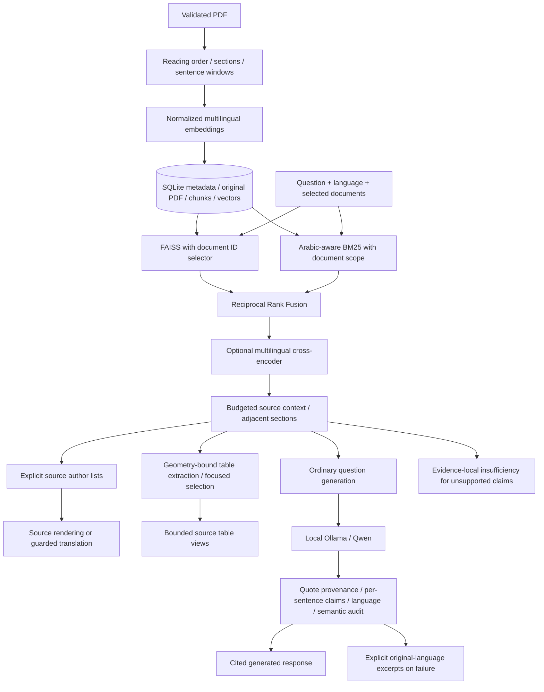

# Current implementation

`src/rag/service.py` coordinates the independent components. Document filters run
inside FAISS and BM25 **before top-k truncation**, including reranked candidates.
Filename inference is only a convenience; explicit dashboard selection is more
reliable. Unknown scope IDs are errors, never an implicit search of all documents.

Ordinary overview questions can add the selected paper's Abstract as context.
Those anchors carry score zero: they are source context, not manufactured
retrieval matches. Standard `/search` metrics do not include this chat-only
context expansion, so retrieval metrics and final answer quality remain separate.

The source-list route recognizes explicit declarations and source-counted ordinals,
inline numbers, Roman numerals and bullets. It does not contain paper-specific gold
answers. It refuses incomplete/ambiguous source lists. Source-authored units stay
complete; translated units receive additional language/meaning checks.

Tables use PDF word/cell geometry, native source fragments and conservative role
checks. Nearby captions above a table take priority over the following table's
caption; accepted captions cannot be reused by another table on that page.
Unsupported layouts fail closed. Explicit table IDs, prompting conditions and
model names narrow the view. Requested weaker models remain in comparisons;
broad summaries have row/column/table caps and label omissions. These are source
views, not a claim that every model or result in a paper has been enumerated.

Ordinary generation uses a shorter task-specific prompt and bounded structured
statements. Multi-sentence generated items become individually cited/audited
claims, not a single terminal citation over uncited prose. Reference IDs and
exact original-PDF quotations remain immutable. Semantic judging sees source
metadata for reference resolution; metadata is not factual evidence. Requirement
flags are not verdict labels. False optional switches are omitted from judge
input, while the server still enforces supported/complete/direct verdict checks.

Generation, repair, translation and semantic audits share an overall deadline.
The default four-statement budget applies to ordinary generated prose, not to
source-counted author lists. Context size and time limits are configurable for
CPU memory/latency. Models can still fail or disagree: this is not a guaranteed
entailment oracle. No response-mode label is a correctness grade.

Responses distinguish `ollama`, `source-contributions`, `translated-contributions`,
`source-tables`, `insufficient-evidence`, and `extractive`. Excerpts may retain the
source language when no verified translation exists; this is disclosed rather
than labeled a successful Arabic answer. The dashboard shows mode descriptions,
unique source captions, all distinct verified quotations, and retrieval metadata.
