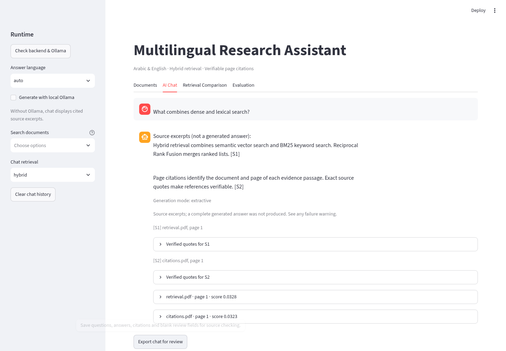

# Daily project workflow

Use this after installation to test the assistant, record reproducible failures,
and prepare a demonstration. Your laptop installation and its backups are separate
from the cloud checkout; cloud validation does not prove your Windows services run.

## 1. Preserve the working installation

Stop the API and dashboard in their terminals before backing up. Keep a copy of
`.env`, `data/`, and your source folder outside the project directory. The source
archive deliberately excludes personal documents, indexes, settings and model caches.
Follow [safe upgrade instructions](upgrading.md) when updating an existing installation.
Do not automatically reindex or replace an existing database.

From the project root, verify the installed source and start its services:

```powershell
.\.venv\Scripts\python.exe -m pytest -q
.\scripts\start.ps1
```

If PowerShell policy prevents the launcher, use the manual server commands in the
README. The Windows launcher has not been executed in this Linux cloud.

## 2. Check one paper at a time

In the dashboard, select the document under **Search documents**, choose the answer
language and ask a focused question. Test definition/problem, methodology, numerical
table results, a limitation or explicit negative statement, and an unsupported premise.
For numeric questions, name the table, model and prompting condition.

Inspect the original PDF page for each answer. Ask separately:

- Does the answer address **every requested part**?
- Does each cited passage support its particular claim and relationship?
- Are values, model names, conditions, negations and future/current scope correct?
- Is the answer in the requested language? Is it an answer or only fallback excerpts?

`ollama` and exact citations do not certify completeness or correctness. The small
Qwen model can produce individually supported facts that omit the requested point.
Arabic fallback is still a known limitation. See the latest validation report.

Use **Export chat for review** in AI Chat. The JSON contains questions, request
settings, responses/citations, failed requests and blank review fields. Expected
answers are never fabricated. The file contains the retrieved source passages;
keep it with your research material. A failed request now remains visible after rerendering.



## 3. Run the repeatable batch

`data/evaluation/workflow-review.json` freezes seven development checks on
ArabLegalEval, AraTable and AceGPT. It includes paper SHA-256 values, reference
page/quote checks and expected facts recorded before this run. Original papers
are not redistributed; copy the matching PDFs from your research collection to a
folder, retaining the filenames in the suite. A different PDF version is refused.
These are development controls, not a pristine unseen-paper benchmark.

The workflow **always creates a new index inside a new output directory** and
refuses existing outputs. It never uses or migrates your active `RAG_DATA_DIR`.
Preflight checks original hashes and exact reference-page quotations before any
run output is created. Gold expectations are not passed to the answer generator.

Quick offline wiring run, without calling Ollama:

```powershell
.\.venv\Scripts\python.exe -m scripts.validate_workflow --sources "C:\path\to\papers" --output reports\review-offline-001 --profile offline
```

This uses hash/lexical retrieval and source excerpts. It does not demonstrate
learned retrieval or generated answer quality. For actual learned/Qwen checks:

```powershell
.\.venv\Scripts\python.exe -m scripts.validate_workflow --sources "C:\path\to\papers" --output reports\review-live-001 --profile learned
```

The learned profile requires the installed model dependencies, configured local
Ollama model and multilingual embedder. It forces learned embeddings even if your
`.env` uses the offline hash backend. It uses hybrid retrieval without cross-encoder
reranking. It records actual generation limits and model names. Optional diagnostic
flags `--context-chars 6000 --max-statements 3` reproduce the cloud CPU run, but
smaller budgets can reduce coverage and are not a general quality recommendation.

The output contains:

| File | Purpose |
|---|---|
| `reference.json` | Frozen source identities, questions and source-checked expectations |
| `answers.json` | Run ID/time, model configuration and actual answers/errors |
| `review.csv` | Ungraded source-review sheet bound to the exact run and responses |
| `index/` | Isolated original PDFs, chunks and index for this run |

The same-name document runner now refuses ambiguous names unless a document ID
is provided. The workflow supplies the preverified PDF hash for every question.

## 4. Review, then summarize

Open `review.csv` with a text editor or import all columns as text in a spreadsheet.
Edit **only** `reviewer`, `reviewer_type`, `verdict` and `notes`. Use `human` or
`ai_assisted` for reviewer type; use `pass`, `partial`, `fail` or `not_reviewed`.
A completed verdict requires a reviewer/type, and partial/failing cases require
an explanation. Model provenance/language checks are evidence, not prefilled grades.

A pass should mean the answer satisfies the expected points, has no material
unsupported claims, and uses valid references and the requested language. Use
partial when a supported answer omits a requested aspect. A fallback can be a safe
system behavior while still failing to deliver the requested research answer.

```powershell
.\.venv\Scripts\python.exe -m scripts.review_run summarize --run reports\review-live-001 --reviews reports\review-live-001\review.csv --output reports\review-live-001\review-summary.json
```

The summarizer refuses a stale run, changed question/answer/reference fields,
missing rows and duplicate rows. Unreviewed work gets no accuracy score; human
and AI-assisted judgments have separate counts/rates. CSV formula prefixes are
neutralized on export. File hashes detect accidental mismatches, not a trusted signature.

To generate another blank sheet without overwriting the original:

```powershell
.\.venv\Scripts\python.exe -m scripts.review_run export --run reports\review-live-001 --output reports\review-live-001\review-second.csv
```

## 5. Turn each failure into a fix

Record the exact question, source/version/page, settings, expected facts, returned
answer and what failed. Classify it as extraction, retrieval, missing evidence,
answer coverage, citation/relationship, translation, timeout or UI error. Preserve
the original failing run. Add a focused regression for a diagnosed code defect,
then rerun the affected cases into a new directory. Do not rewrite expectations
around the model output or weaken citation checks to improve a score.

When comparing a more capable local model, use the same frozen suite, record the
actual tag/quantization and review the new answers. Do not claim Arabic quality
improved until the paper-level checks demonstrate it. No new model or paid API
is required by the workflow itself.

## 6. Demonstrate and decide what is ready

Show PDF indexing, document selection, one cited answer, one table comparison,
a justified insufficient-evidence response and chat export. Show a known limitation
as well. Use the offline fixture demo for reproducible wiring; label it synthetic.

Before calling the project finished, independently review additional papers,
verify Windows startup on the actual laptop, inspect GitHub CI, and resolve or
explicitly accept remaining Arabic/coverage failures. Passing software tests
alone is not a scientific answer-quality benchmark.
